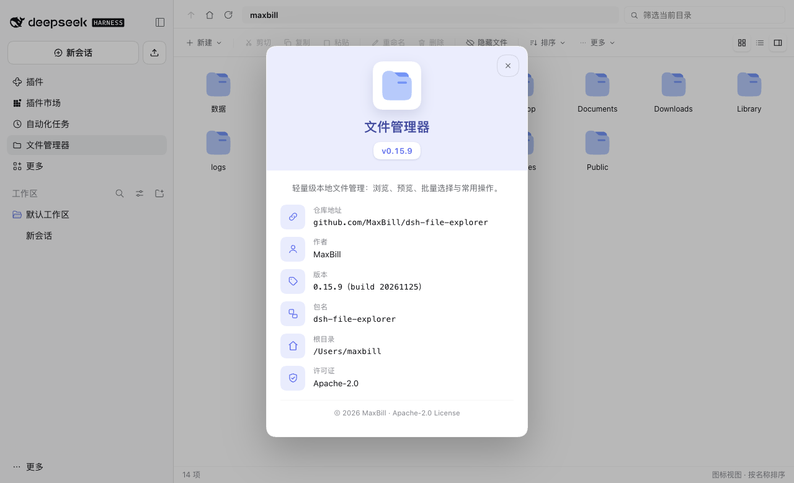
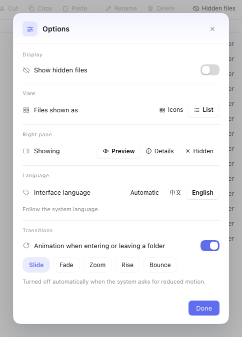
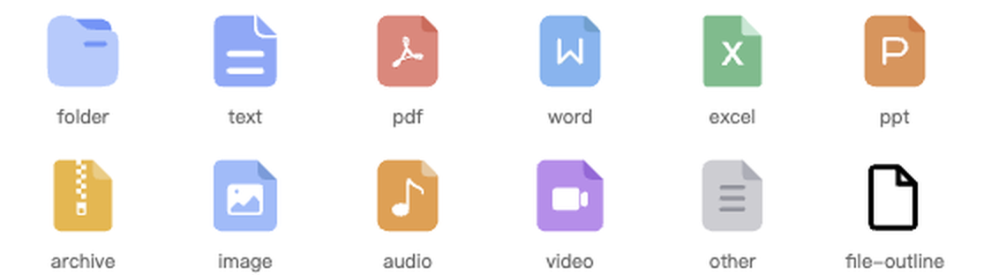

# File Explorer · dsh-file-explorer

[简体中文](README.md) | **English**

A **文件管理器** entry in the DeepSeek Harness left sidebar that opens a real working file panel in the main column: icon and list views, text and image previews, draggable column widths, and a full context menu. What sets it apart is that it is **wired into DSH itself** — right-click a folder to turn it into a workspace, right-click a document to hand it to the current conversation.

> Most file plugins stop at "you can look at files". This one takes the next step: **browse → find → straight into a workspace or straight into the conversation**, with no Finder detour, no copying paths, no moving the file somewhere first.

| List view with the context menu | Icons view |
|:--|:--|
|  |  |




Repository: <https://github.com/MaxBill/dsh-file-explorer> · Developer: [MaxBill](https://github.com/MaxBill) · License: Apache-2.0

## Two DSH-specific actions

Any file browser can list a directory. The saving is in what happens **after** you find the file, so these two get their own section:

### ① 添加为工作区 — on a folder

Right-click any folder → **添加为工作区** → confirm. The sidebar's 工作区 list immediately gains an entry, and a new session opened there gives the agent read/write, terminal and search scoped to that directory.

What it saves is the detour: back to DSH, find "add workspace", then click down from your home directory to the folder you were already looking at.


### ② 添加到会话 — on a document

Right-click an image, text, PDF, Word, Excel or PowerPoint file → **添加到会话**. The panel switches back to the current conversation with the attachment card already in the composer — exactly what dropping the file on the input or using the paperclip produces, without leaving the file manager to find it.

Then just ask: "which months overspent in this spreadsheet?" or "summarise the conclusions in this PDF".


### ③ 引用到输入框 — on a file

For when you would rather not put the bytes into the context: right-click → **引用到输入框** inserts `@/absolute/path` into the composer, and the agent reads the file only when it needs to. Best for code, logs, large files and anything still being edited — cheaper in tokens, and size limits never get in the way.


### In practice

- **Starting a project**: glance at the icon grid → double-click into the folder → right-click 添加为工作区 → have the agent read the code and run the build.
- **Reading a report**: sort the list by modified time → right-click the xlsx → 添加到会话 → "total the Q3 spend into a table".
- **Tidying names**: `F2` to rename, `⌘Z` when you regret it, drag a header divider when the columns feel cramped.

## What it does

- **Left sidebar entry** — registered in `sidebar.panellist` with a folder glyph; the same id addresses the panel registered in the `main` keyed slot.
- **Plugin-page icon** — `package.json`'s `icon` points at `icon.svg` (the purple folder), which is what the installed-plugins list shows.
- **Browsing** — breadcrumbs, up, home, refresh; double-click a folder to enter it.


- **Two languages** — the interface speaks **中文 and English**; 选项 → 语言 switches between 自动 (follow the system), 中文 and 英文/English, and the choice is remembered. The language names follow the interface too: 自动 / 中文 / 英文 in Chinese, Automatic / Chinese / English in English. The panel and its dialogs switch instantly; the sidebar entry's name is fixed when the plugin loads, so a refresh brings that in line. Chinese is the default, for the UI and for this repository's default README.
- **Navigation motion** — entering a folder slides the listing and its header in from the right; going up (↑, a parent breadcrumb, Backspace, home) slides them in from the left — 60 px of travel with a slight scale over 340 ms. 选项 → 切换动画 picks between **滑动** (the default), **淡入**, **缩放** (0.9 → 1), **上浮** (26 px from below) and **回弹** (a sliding entry with a little overshoot), and a master switch turns the whole thing off. In-place reloads (refresh, a rename) always just fade, the choice is remembered, and the animation is off when the system asks for reduced motion.
- **Address bar** — the tinted breadcrumb strip doubles as a path field: double-click it (or press `⌘L`), type an absolute, relative or `~` path and press Enter. `Esc` cancels, and a path outside the home root is refused.
- **Filter and sort** — live name filter; the list carries 名称 / 类型 / 大小 / 修改时间 column labels (the active one shows an arrow and any label can be clicked), and the toolbar's 排序 menu does the same, with folders always first.
- **View modes** — the two icons at the far right of the toolbar switch **icons / list** (⌘1 icons, ⌘2 list, Ctrl on Windows). **Icons is the default**: the folder lays out as a grid. The list shows name, type, size and modified time in one row. The choice is remembered for the next session.
- **Column widths** — hover the dividers between the list headers (名称 / 类型 / 大小 / 修改时间) to get a resize cursor, then drag: that column widens or narrows, and **double-clicking a divider restores its default width**. 名称 shares the leftover space until you drag it, then it becomes a fixed width. Widths persist in the browser, so the panel reopens exactly as you left it.
- **Hidden files** — dotfiles are hidden by default; the 隐藏文件 button in the toolbar shows them.
- **Status bar** — item count, selection size and clipboard on the left; the current view mode and sort key on the right.
- **About** — 更多 → 关于 opens an About window with a tinted header (app icon, name, version pill) over three rows — author, version with build date, and the repository as a clickable link — plus a copyright line carrying the licence, all read from `package.json` so it cannot drift from the release.
- **Preview** — the right pane routes by extension, covering the same ground as DSH's own document preview, and streams from the host's `/api/file-explorer/raw` instead of base64 data URLs:

  | Type | Extensions | Renderer |
  |:--|:--|:--|
  | Images | png / jpg / jpeg / gif / webp / bmp / ico / svg | `` straight from `/raw`, no size cap from base64 |
  | PDF | pdf | `<embed type="application/pdf">` (the browser's reader: paging and zoom) plus an "open in a new window" link |
  | Markdown | md / markdown | Built-in lightweight renderer: headings, bold/italic, inline code, links, lists, quotes, fenced code |
  | Tables | csv / tsv | Parsed into a table (first row is the header, quoted commas supported), up to 200 rows |
  | Excel | xlsx / xlsm | Parsed by the host itself (zip + XML, no third-party library), with a tab per worksheet, first row as the header, up to 500 rows × 60 columns |
  | Word | docx / docm | Also host-parsed: headings, body text, bullets and **tables** rebuilt in document order, text only (images, headers/footers and comments are skipped) |
  | HTML | html / htm | Sandboxed iframe (`sandbox`, scripts do not run) |
  | Audio / video | mp3 / wav / m4a / flac / ogg / opus / aiff; mp4 / mov / webm / ogv | Native `<audio>` / `<video>` players — DSH itself does not preview these |
  | Text / code | the rest of the text kinds | Monospace, up to 512 KB |
  | Everything else | binaries, Office | Metadata plus "Open with default app" | The pane **starts collapsed** — the panel opens in the icons view with no right pane, so the listing uses the full width. The preview icon at the far right of the toolbar collapses or restores the right-hand pane; collapsed, the list takes the full width.


- **Details pane** — right-click "显示详情", or flip the right pane to 详情, to see name, type, size, location, created, modified and permissions. Folders have no preview, so selecting one shows its details (size reads as an item count).
- **Quick toolbar** — **新建** (new folder / new file) first, then cut, copy, paste, rename and delete, then **排序** (name / size / modified) and **更多** (undo, select all, deselect all, invert selection, options, about) on the right. 选项 opens a settings window (not a submenu) with four sections: 显示 (hidden files switch), 视图 (图标 / 列表 segmented control), 右侧面板 (隐藏 / 预览 / 详情, with 隐藏 as the default) and 切换动画 (a master switch plus the effect picker) — all of it mirrors the toolbar's own toggles. Everything there matches the toolbar's own icon group, so either can drive it, and **every setting is remembered** — hidden files, view, the right pane's visibility and mode, language and the transition effect all live in the browser, so closing the panel or reloading the page keeps them. A small sample strip under the effect pills replays the chosen animation as soon as you pick it. Buttons grey out when nothing is selected.
- **Multi-select** — `⌘`-click to add or drop single rows, `⇧`-click to select a range; cut, copy and delete act on the whole selection.
- **Undo** — delete, rename, move and create can all be undone (the last 20 steps), and the listing refreshes afterwards.
- **Context menu** — right-click a file or folder, or the empty area, for the common operations (see below).
- **Keyboard** — `↑`/`↓` to select, `Enter` to open, `Backspace` to go up, `F2` to rename, `⌘C`/`⌘X`/`⌘V` to copy, cut and paste, `Delete` to move to the Trash, `⌘1`/`⌘2` to switch views, `⌘A` to select all, `⌘⇧A` to deselect all, `⌘⌥A` to invert, `Esc` to clear, `⌘L` to edit the address bar.
- **Remembers the folder** — switching to another panel and back keeps the last directory.

## Context menu

**File or folder**: preview (open, for folders), open with the default app, reveal in Finder, rename…, duplicate, copy, cut, copy path, copy name, move to Trash.

**Files also get**: **引用到输入框** — inserts `@/absolute/path` into the current conversation's composer (no content copied; the agent reads it on demand). Good for code, big files, or files you are still editing: same intent as 添加到会话, but it points at the file instead of carrying it.

**Common documents also get**: **添加到会话** — images, text, PDF, Word, Excel and PowerPoint files can be handed straight to the current conversation (the same thing as dropping them on the composer; an attachment card appears there). The bytes come from the new `/api/file-explorer/raw` host route.

**Folders also get**: **添加为工作区** — asks for confirmation first ("确认要将 xxx 添加为 DSH 工作区？"), then registers the folder through the client's `workspaces.create({ path })`, so it appears in the sidebar's 工作区 list right away; adding the same path twice reports the host's reason, and cancelling does nothing.

**Empty area**: new folder…, new file…, paste, reveal this folder, refresh.

- Copy and cut put the path on the panel's own clipboard; pasting in another folder copies or moves it, and the footer shows what is on the clipboard.
- Move to Trash asks first, then moves the item into `~/.Trash`, so it stays recoverable.
- No write operation overwrites: a name clash becomes `name 2` / `name 副本` (or a `409` for a rename onto an existing name).
- Rename and create use in-panel dialogs: `Enter` confirms, `Esc` cancels, and rename preselects the name without its extension.

## Safety

Every requested path is resolved with `realpath()` before the containment check, so neither `..` segments nor symbolic links escape the browsing root. The root is the current user's home directory, and out-of-root requests answer `403`.

Limits: 512 KB of text, 8 MB of image, 2000 entries per directory (the footer says when a listing is truncated).

## Layout

| File | Role |
|:--|:--|
| `lib/index.js` | Host half: registers the `/api/file-explorer` prefix route on the DSH web server (`roots`, `list`, `read`, `reveal`) |
| `lib/client.js` | Browser half: a `window.__ModuleLoader__` factory module registering the sidebar icon and the `main` panel |
| `cordis.patch.yml` | Bundle patch that inserts the `dsh-file-explorer` Loader entry (the row id matches the package name) |

Icons are inline SVG: `SHAPES` accepts either a 24-grid stroke path list or `{ viewBox, parts: [{ d, fill }] }` filled artwork. The listing uses **eleven two-tone icons**: folder, text, PDF, Word, Excel, PowerPoint, archive, image, audio, video, and a neutral "other file" for everything else. Each `viewBox` was recomputed from its artwork's bounding box so every long edge is 88% of the box, which keeps them the same visual size at 44px in the grid and 16px in a row.

## Icon assets

`assets/icons/` ships the twelve SVGs as standalone files: folder, text, PDF, Word, Excel, PowerPoint, archive, image, audio, video, the neutral "other file", and the stroke fallback.



They are exported from the very same `SHAPES` table the bundle renders, so they never drift from what the UI shows:

```bash
node scripts/export-icons.mjs   # re-run after touching the artwork
```

The browser half keeps the artwork inline for zero extra requests; `assets/icons/` is the browsable, reusable copy.

## Install

The plugin mounts the standard DSH bundle way:

```jsonc
// ~/.dsh/profiles/<profile>/package.json
{
  "dependencies": { "dsh-file-explorer": "link:../../plugins/dsh-file-explorer" },
  "dsh": { "profile": { "bundles": [ "dsh-file-explorer" ] } }
}
```

Then run `pnpm install` in that profile directory and restart DSH. `dsh plugin --profile <profile> add <path>` does the same through the CLI.

Installing from source:

```sh
git clone https://github.com/MaxBill/dsh-file-explorer.git ~/.dsh/plugins/dsh-file-explorer
```

Then point the `link:` dependency above at that directory.

## Development

```sh
npm test        # exercises the host HTTP API in a scratch folder under $HOME, then cleans up
```

There is no build step: `lib/index.js` is plain ESM and `lib/client.js` is a hand-written `window.__ModuleLoader__` factory module.

## Uninstall

Remove `dsh-file-explorer` from `dsh.profile.bundles` and `dependencies`, then run `pnpm install` again.

## Developer

| Field | Value |
|:--|:--|
| Developer | **MaxBill** |
| Homepage | <https://github.com/MaxBill> |
| Repository | <https://github.com/MaxBill/dsh-file-explorer> |
| Issues | <https://github.com/MaxBill/dsh-file-explorer/issues> |

## License

[Apache License 2.0](LICENSE) © 2026 MaxBill

Commercial use, modification and redistribution are permitted with the copyright and licence notices retained and any NOTICE file passed on (section 4); it also grants an express patent licence and comes with no warranty.