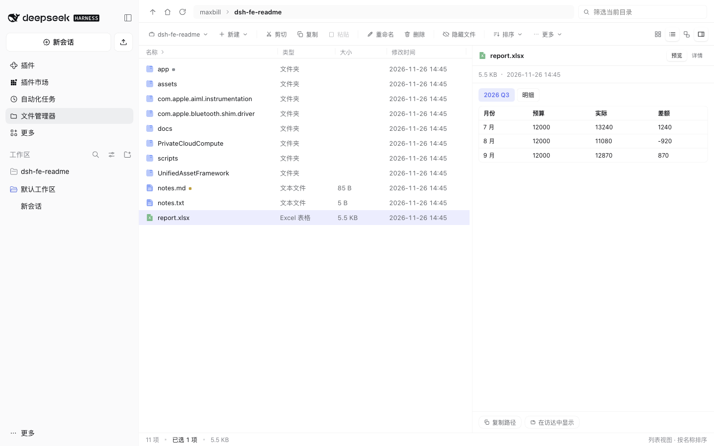
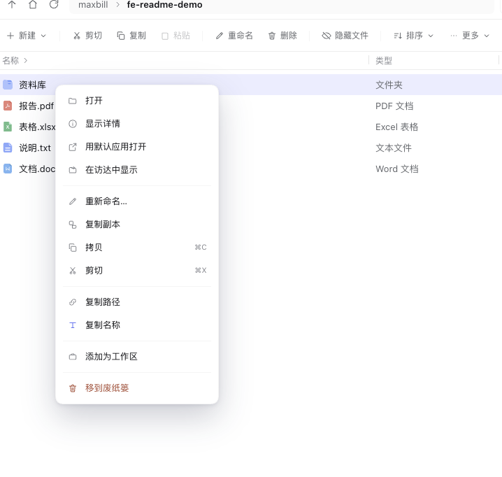
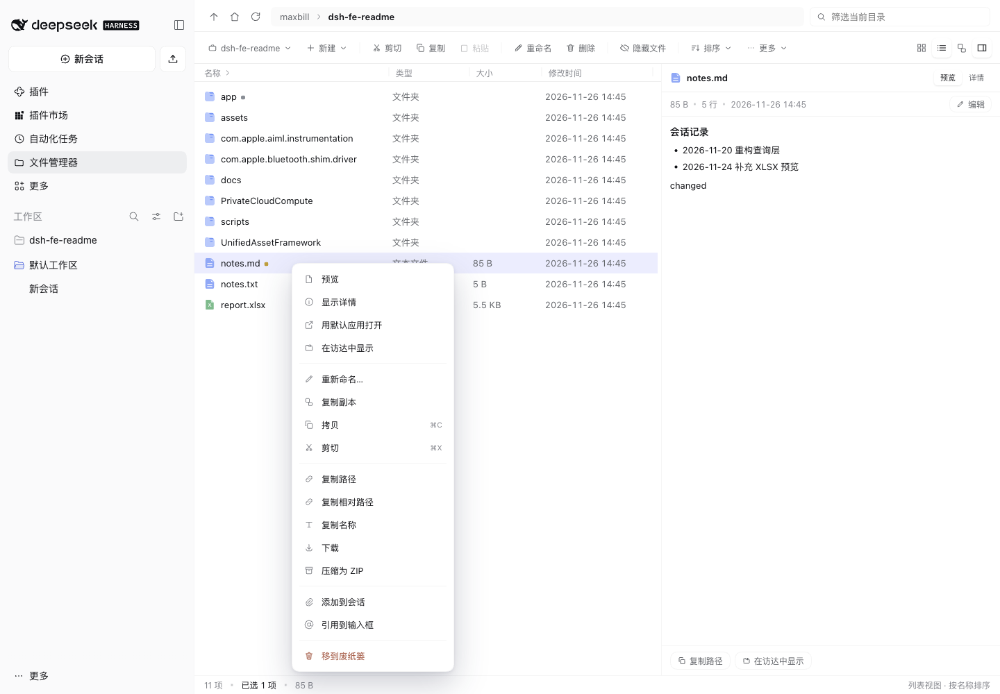
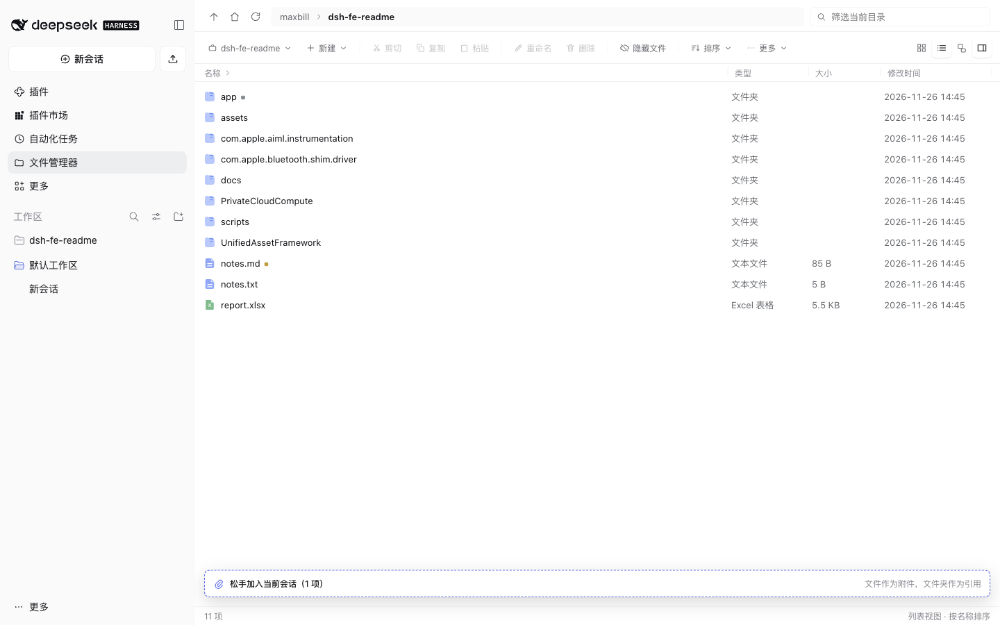
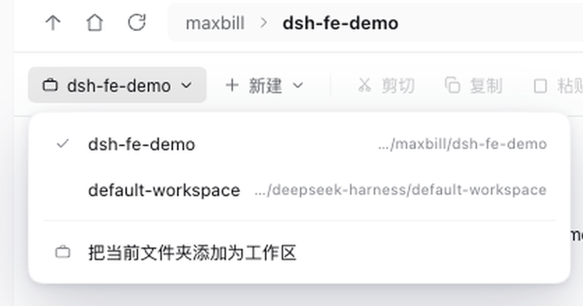
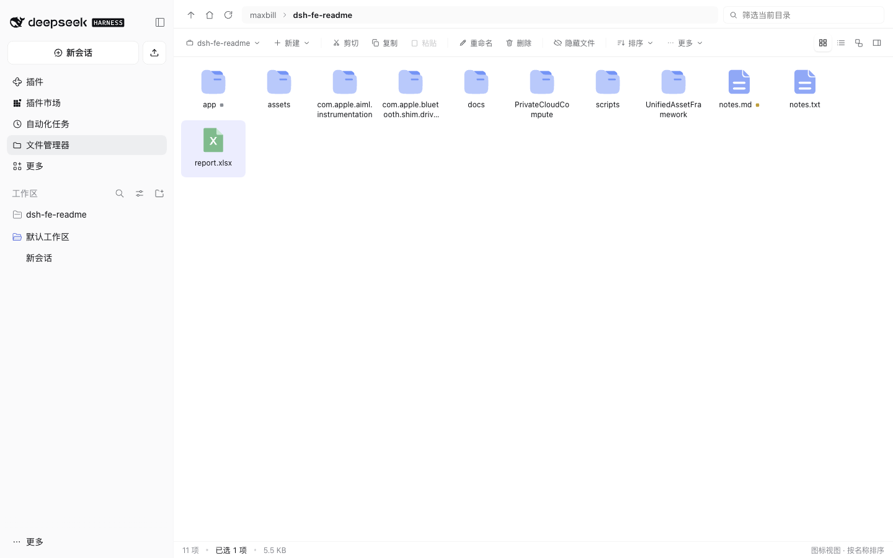
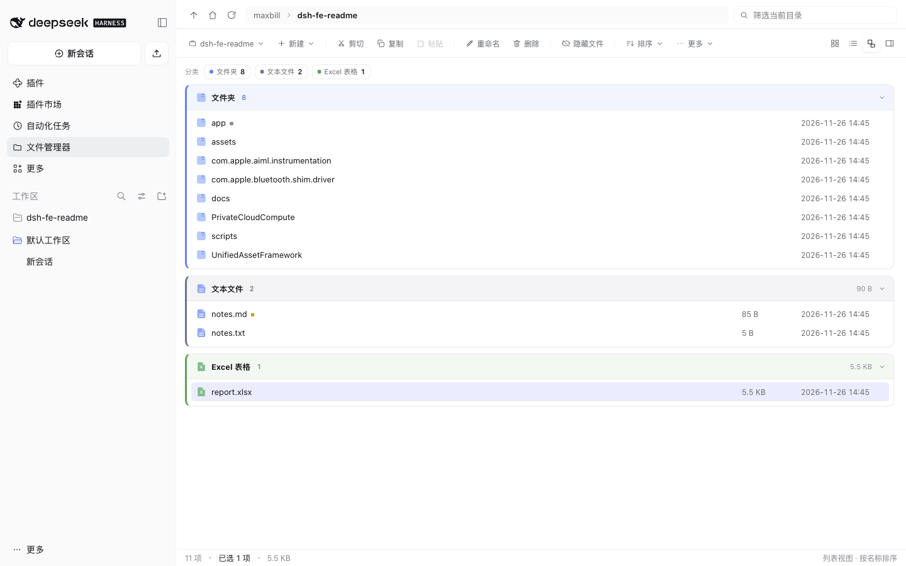
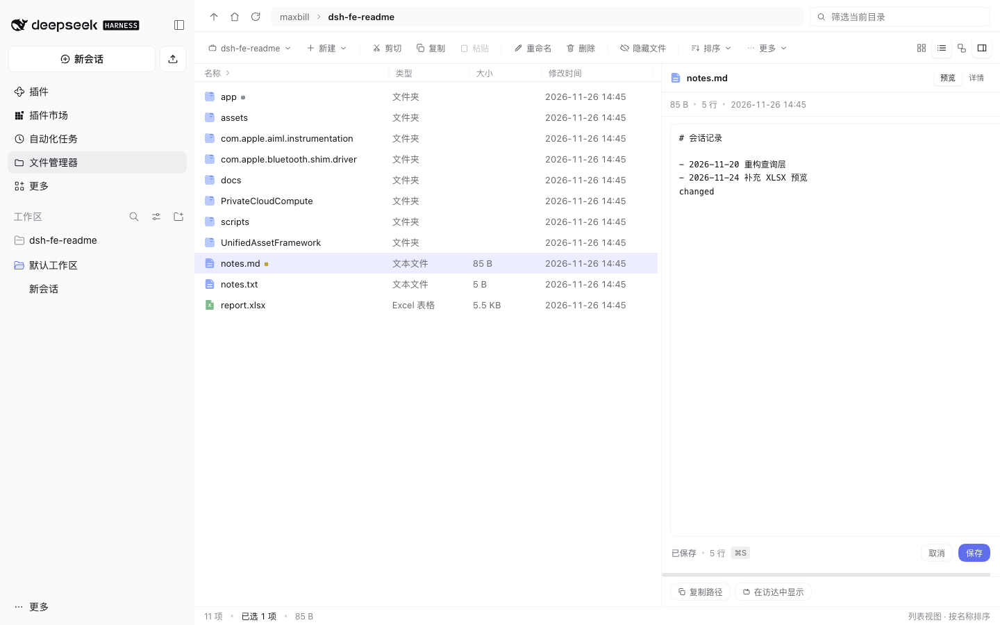

# File Explorer · dsh-file-explorer

[简体中文](README.md) | **English**

A **file manager** for DeepSeek Harness: one entry in the left sidebar, one panel in the main column — three views, previews by type (including XLSX and DOCX), in-panel text editing, one-click workspace switching, and a way to hand a file straight to the current conversation.

> Most file plugins stop at "you can look at files". This one takes the next step: **finish looking and keep working** — right-click a folder to make it a DSH workspace, or drop a document into the current conversation, without opening Finder or copying paths.



---

## Five things it does together with DSH

### ① Add as workspace — on a folder

Right-click any folder → **添加为工作区** → confirm. A new entry appears under 工作区 in the sidebar; start a session there and the agent's reads, writes, terminal and search all land inside it.

What it saves: going back to DSH, finding "add workspace", then clicking down from your home directory to the target folder.



### ② Add to conversation — on a document

Right-click an image, text, PDF, Word, Excel or PowerPoint file → **添加到会话**. The panel switches back to the conversation with the attachment card already in the composer — the same result as dropping the file on the input, without leaving the file manager to find it.

Then just ask: "which months overspent in this spreadsheet?"



### ③ Mention in the composer — without spending context

The same menu's **引用到输入框** only inserts `@/absolute/path`; the bytes stay out of the context and the agent reads the file when it needs to. Best for code, logs, large files and anything still being edited.

The difference in one line: **添加到会话** sends the content, **引用到输入框** sends the location.

### ④ Drag into the conversation

Select a file (or a whole multi-selection) and drag it out of the list: a strip rises at the bottom — "松手加入当前会话". Let go and files attach, folders become `@path` mentions. Same destination as 添加到会话, without moving your hand off the mouse.



### ⑤ Switch workspace in one click — left of the toolbar

The leftmost toolbar button names the workspace holding the current folder (or just "工作区"). Open it for every workspace on this machine — path tail shown, the current one ticked — and pick one to jump straight there. The last row registers the current folder as a workspace. It reads the live `ctx.workspaces` snapshot.



---

## What the panel does

### Three views

- **Icons** (default): a 104px grid; names get two lines and then a `…` at a width budget (CJK counts double), with the two-line height always reserved so tiles line up; hover shows the full name.
- **List**: name / type / size / modified at a glance, drag a column divider to resize it, double-click the divider to reset.
- **Grouped**: sections by type (folders, text, images, documents, audio, video, archives, other) with a colour overview strip on top, each section accented with its own colour, count and total size; click a heading to fold it.

Switch with the icons at the far right of the toolbar (`⌘1` icons, `⌘2` list, `Ctrl` on Windows); the choice is remembered.





### Preview and edit

The right pane routes by extension, matching the ground DSH's own document preview covers:

| Type | Extensions | Renderer |
|:--|:--|:--|
| Images | png / jpg / jpeg / gif / webp / bmp / ico / svg | `` straight from `/raw`, no base64 |
| PDF | pdf | The browser's reader, with paging and zoom, plus "open in a new window" |
| Markdown | md / markdown | Lightweight renderer: headings, bold/italic, inline code, links, lists, quotes, fenced code |
| Tables | csv / tsv | Parsed into a table (first row is the header, quoted commas supported), up to 200 rows |
| Excel | xlsx / xlsm | **Parsed by the host itself** (zip + XML, no third-party library), a tab per worksheet, first row as header, up to 500 × 60 |
| Word | docx / docm | Also host-parsed: headings, body text, bullets and **tables** in document order, text only |
| HTML | html / htm | Sandboxed iframe, scripts do not run |
| Audio / video | mp3 / wav / m4a / flac / ogg / opus / aiff; mp4 / mov / webm / ogv | Native players (DSH does not preview these two itself) |
| Text / code | the rest of the text kinds | Monospace, read-only, ≤ 512 KB |
| Other | binaries, Office files | Metadata plus "open with the default app" |

Press **编辑** on a text, Markdown or CSV preview to edit in place: `⌘S` saves, a dirty dot warns about unsaved work, an out-of-date file asks before being overwritten, and the save button is the primary one with a line count on the left. Binary extensions (zip, images, audio/video…) get no edit entry, so bytes that cannot round-trip are never written back.



The right pane also has a **详情** mode: name, type, size, location, created, modified and permissions, plus the item count for folders. The pane starts collapsed; open it with the preview icon at the far right of the toolbar.

### Organising and transferring

- **New** folder / file, **rename** (`F2`, with the name preselected up to the extension), **duplicate**, **cut / copy / paste** through the panel's own clipboard, across folders.
- **Multi-select** with `⌘`-click and `⇧`-click; cut, copy and delete act on the whole selection.
- **Undo** for delete, rename, move and create (20 steps).
- **Move to Trash** asks first and goes to the system Trash, so it stays recoverable; nothing overwrites an existing item — name clashes become `名称 2` / `名称 副本`.
- **Download / zip / unzip**: 下载 saves the file; 压缩为 ZIP writes a sibling archive; on a `.zip`, 解压到此处 extracts it and refuses any entry that would escape the target folder. The host builds archives with `zlib` itself.
- **Upload** (remote only): streams onto the host's disk without buffering, with a progress bar, 512 MB per file. In the host's own browser the row is hidden — that file already sits on the same disk, so Finder or 新建 / 粘贴 is the direct route.
- **Git badges**: inside a repository, modified / untracked / staged / deleted / conflicted entries get a coloured dot with a hover explanation; it only reads `git status --porcelain` with `GIT_OPTIONAL_LOCKS=0`.
- **Address bar**: double-click the breadcrumbs (or `⌘L`) for an editable path — absolute, relative, `~` and `..`; `Esc` cancels, and anything outside the browse root is refused.
- **Filter and sort**: live name filter; click the name / type / size / modified headers, folders always first.
- **Status bar**: item count, selection size and clipboard on the left, current view and sort on the right.
- **Remembered**: hidden files, view, group style, pane mode, language, animation, column widths and the last folder all live in the browser.

### Look and settings

- **Transition**: 滑动 by default, plus 淡入, 缩放, 上浮 and 回弹; in-place refreshes only fade. `prefers-reduced-motion` turns it off.
- **Two languages**: 中文 and English, switched in 选项 → 语言 (「自动」 follows the system by default).
- **Options window**: 更多 → 选项 gathers display, view, group style, right pane, animation and language; it stays in sync with the toolbar icons.
- **About**: version, author, build date and licence, read straight from `package.json`.

---

## Context menu

| Where | Entries |
|:--|:--|
| File / folder | preview (open, for folders), details, open with the default app, reveal in Finder, rename…, duplicate, copy, cut, copy path, copy relative path, copy name, download (files only), compress to ZIP, extract here (.zip only), move to Trash |
| Files also get | **添加到会话** (images, text, PDF, Word, Excel, PowerPoint), **引用到输入框** |
| Folders also get | **添加为工作区** |
| Empty area | new folder…, new file…, paste, reveal this folder, refresh |

---

## Platform support

| Capability | macOS | Windows | Linux |
|:--|:--|:--|:--|
| Browse / preview (XLSX · DOCX included) / edit / upload / download / zip | ✅ tested | ⚠️ untested | ⚠️ untested |
| Open with the default app | ✅ `open` | ✅ `cmd /c start` | ✅ `xdg-open` |
| Reveal in the file manager | ✅ `open -R` | ✅ `explorer /select,` | ✅ FileManager1 (falls back to opening the folder) |
| Move to Trash | ✅ `~/.Trash` | ✅ Recycle Bin via PowerShell, falling back to `~/.Trash` | ✅ freedesktop Trash with `.trashinfo` |
| Typing a path | ✅ POSIX | ✅ drive letters `C:\dir` and UNC `\\server\share` | ✅ POSIX |
| Upload a whole folder | ✅ | ✅ | ✅ `webkitdirectory`: Chrome / Edge / Firefox, not Safari (falls back to picking files) |

> ⚠️ **Windows and Linux have not been verified on real machines.** Both branches follow the platform's own conventions (Explorer's `/select,`, the Recycle Bin's `SendToRecycleBin`, the freedesktop `files`+`info` layout) and `npm test` simulates all three systems in "platform plan" cases, but nobody has clicked through it on those systems yet. If something breaks, please open an [issue](https://github.com/MaxBill/dsh-file-explorer/issues) with your OS version, the DSH log line and the steps.

### What changes over a remote connection

When the page is reached over the LAN or a tunnel, the actions that **run on the host and need a desktop session** are hidden, and the status bar says 远程访问 · 本机操作已隐藏:

- Reveal in Finder / Explorer (including the empty-area entry and the preview pane's button)
- Open with the default application
- Move to Trash (with the toolbar's delete button and the `Delete` shortcut)

**Upload** is the mirror image: it appears only remotely, because that is the way to put your machine's files onto the host, and it carries a "从本机上传" hint. Browsing, previewing, editing, downloading, zipping, git badges, attaching, mentioning and adding a workspace all stay.

Detection: the host answers `/env`; a loopback Host counts as local, and a browser whose OS differs from the host's (a common SSH-forward case) is treated as remote.

## Safety

Every path goes through `realpath()` before checking, so `..` and symlinks cannot leave the browse root (the current user's home); anything else gets `403`. Preview limits: 512 KB of text, 8 MB of image, 2000 entries per directory (the footer says when a listing is truncated).

All 23 host routes are registered on DSH's `connection` service (`ctx.connection.fetch.register`), so authentication, the Host / Origin fence and the browser session are enforced by DSH itself.

---

## Install

The package is **`@maxbill/dsh-file-explorer`** (the unscoped `dsh-file-explorer` name was taken on npm, hence the scope). Pick any of three routes:

**① From GitHub (no npm)**

```sh
git clone https://github.com/MaxBill/dsh-file-explorer.git ~/.dsh/plugins/dsh-file-explorer
dsh plugin --profile desktop add link:$HOME/.dsh/plugins/dsh-file-explorer
```

**② From npm** (not published yet — works once the package is on the registry)

```sh
dsh plugin --profile desktop add @maxbill/dsh-file-explorer
```

**③ Hand-write the profile**

```jsonc
// ~/.dsh/profiles/<profile>/package.json
{
  "dependencies": { "@maxbill/dsh-file-explorer": "link:../../plugins/dsh-file-explorer" },
  "dsh": { "profile": { "bundles": [ "@maxbill/dsh-file-explorer" ] } }
}
```

Then run `pnpm install` in that profile directory and restart DSH. A 文件管理器 entry appears in the left sidebar.

> The **Loader entry id is still `dsh-file-explorer`** (the `id:` in `cordis.patch.yml`); only the module name became scoped.

## Uninstall

Remove `@maxbill/dsh-file-explorer` from `dsh.profile.bundles` and `dependencies`, then run `pnpm install` again.

## Development

```sh
npm test        # host HTTP tests, run in a temporary directory under $HOME and cleaned up
```

There is no build step: `lib/index.js` is plain ESM and `lib/client.js` is a hand-written `window.__ModuleLoader__` factory module.

**Publish to npm** (maintainers): `package.json` already sets `publishConfig.access = "public"`, so once you are logged in it is one command.

```sh
npm login                                   # an account that owns the @maxbill scope
npm publish                                 # ships lib / assets / docs / locale
```

Keep the version in `package.json` equal to the GitHub Release tag.

| File | Purpose |
|:--|:--|
| `lib/index.js` | Host side: registers the 23 `/api/file-explorer` routes on DSH's `connection` service, every path `realpath`ed inside `$HOME` |
| `lib/client.js` | Browser side: the sidebar icon and the `main` panel, zero dependencies beyond `react` |
| `cordis.patch.yml` | Bundle patch that inserts the `dsh-file-explorer` Loader entry |
| `assets/icons/` | 12 reusable two-tone SVGs (`node scripts/export-icons.mjs` exports them from `SHAPES`) |

## Branch model

- `main`: stable; only reaches it through a PR from `develop`, with branch protection on (admins included, no force-push, no deletion).
- `develop`: day-to-day work; merge after the tests pass.

```sh
git switch develop
# ...code, commit, test...
git push origin develop
gh pr create --base main --head develop
```

Merges are rebased to keep the history linear, then develop is realigned:

```sh
git switch develop && git fetch origin && git reset --hard origin/main
```

## Developer

| | |
|:--|:--|
| Developer | **MaxBill** |
| Profile | <https://github.com/MaxBill> |
| Repository | <https://github.com/MaxBill/dsh-file-explorer> |
| Issues | <https://github.com/MaxBill/dsh-file-explorer/issues> |

## License

[Apache License 2.0](LICENSE) © 2026 MaxBill
