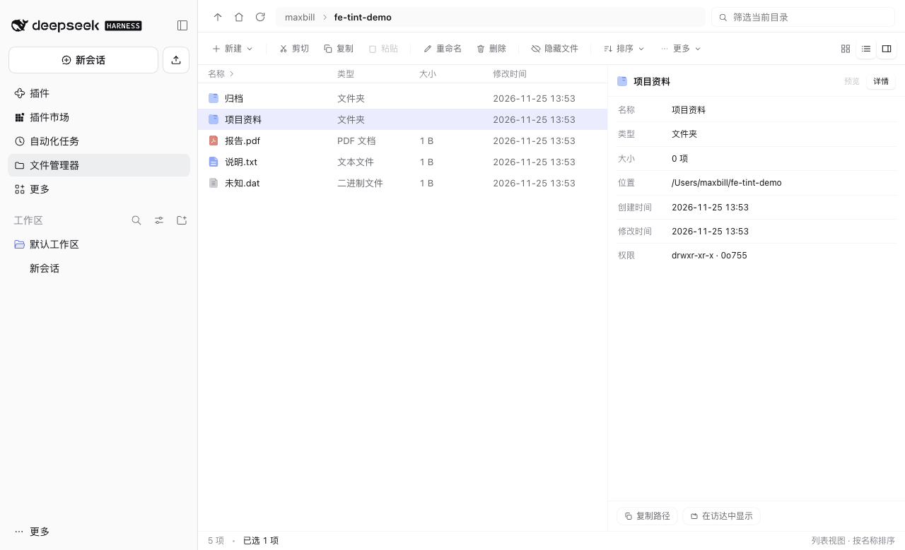
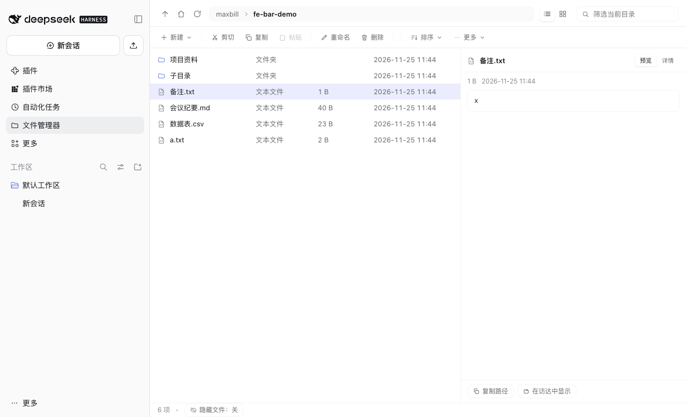
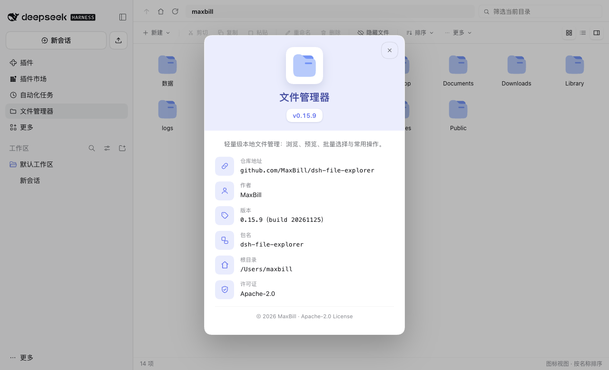
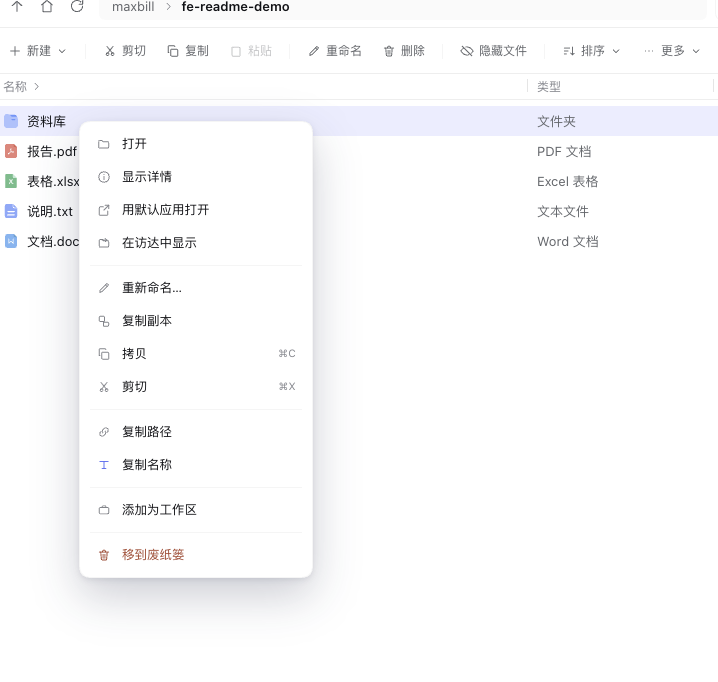
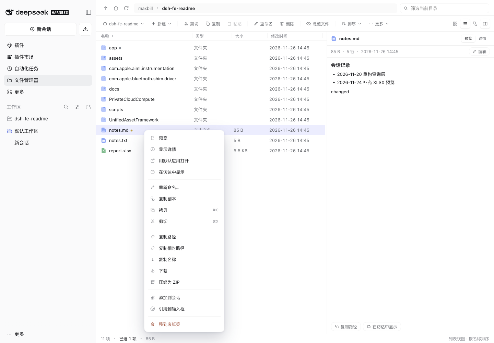
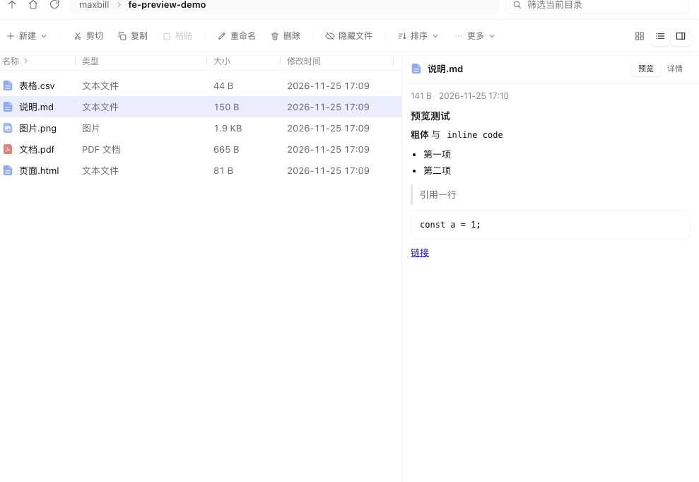
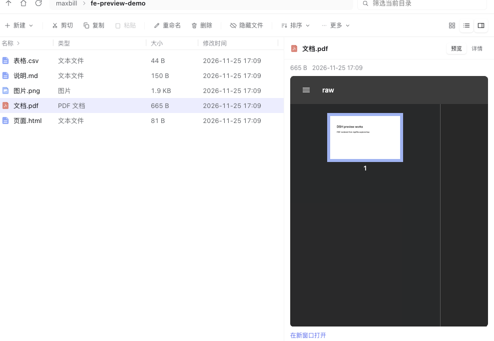
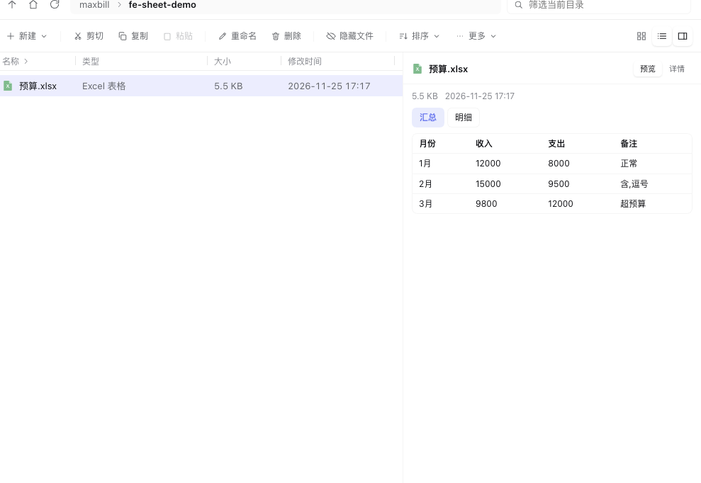
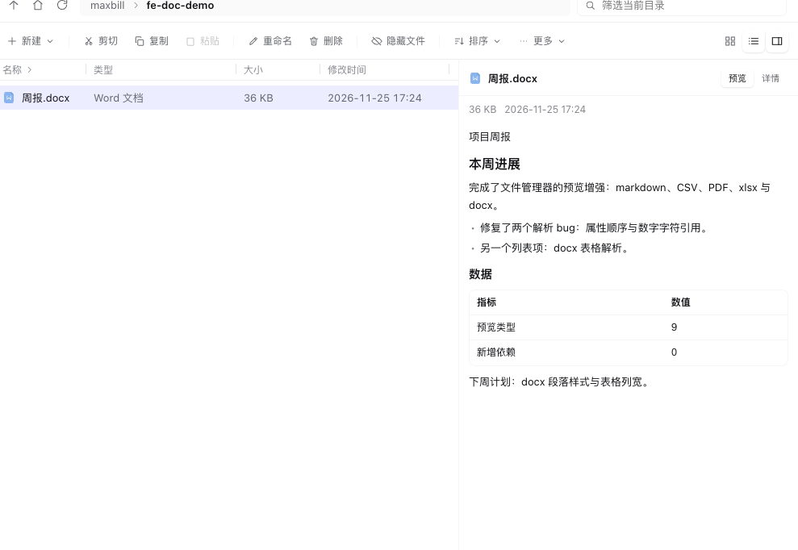
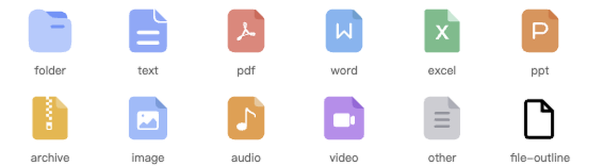

# 文件管理器 · dsh-file-explorer

**简体中文** | [English](README.en.md)

给 DeepSeek Harness 装一个**能干活的**本机文件管理器：左侧栏一个入口，主栏里是一整块面板 —— 图标 / 列表双视图、文本与图片预览、可拖拽列宽、一整套右键操作。更关键的是它**和 DSH 本身打通**：一个文件夹右键就能变成工作区，一份文档右键就能送进当前对话。

> 多数文件插件停在「能看文件」。这个多做了一步：**浏览 → 找到 → 直接变成工作区或直接丢进对话**，中间不用开访达、不用复制路径、不用把文件先挪到某个目录。

| 列表视图与右键菜单 | 图标视图 |
|:--|:--|
|  |  |







仓库：<https://github.com/MaxBill/dsh-file-explorer> · 开发者：[MaxBill](https://github.com/MaxBill) · 许可：Apache-2.0

## 两个 DSH 专属动作

随便哪个文件浏览器都能列目录。真正省时间的是**看完文件接着干活**，所以这两个动作单独说：

### ① 添加为工作区 · 文件夹右键

选中任意文件夹 → 右键 → **添加为工作区** → 确认。左侧栏「工作区」里立刻多一个入口，之后在这个目录开新会话，agent 的读写、终端、检索全落在它下面。

省掉的是那条绕路：先回 DSH 找「添加工作区」，再从主目录一层层点到目标文件夹。



### ② 添加到会话 · 文档右键

图片、文本、PDF、Word、Excel、PPT 右键 → **添加到会话**，面板随即切回当前对话，输入框里已经躺着那张附件卡片 —— 与把文件拖进输入框、点回形针的效果一模一样，但不用先离开文件管理器去找它。

接着直接问就行：「这份表格里哪几个月超预算？」「把这个 PDF 的结论列成三条。」



### ③ 引用到输入框 · 文件右键

不想把内容塞进上下文时用这条：右键 → **引用到输入框**，输入框里出现 `@/绝对/路径`，agent 需要时自己去读。适合代码、日志、大文件，以及还会继续改的文件 —— 省 token，也不会因为超过附件大小而上不去。


### 典型用法

- **开一个项目**：图标视图扫一眼 → 双击进目录 → 右键「添加为工作区」→ 新会话里让 agent 读代码、跑构建。
- **看一份报表**：列表视图按修改时间排序 → 右键 xlsx → 添加到会话 → 「把 Q3 支出汇总成表」。
- **收拾文件名**：`F2` 改名，改错了 `⌘Z` 撤销；列太挤就拖动表头分隔线。

## 功能

- **左侧栏入口**：注册在 `sidebar.panellist`，图标为文件夹；同一 id 打开 `main` 面板。
- **插件页图标**：`package.json` 的 `icon` 指向 `icon.svg`（紫色文件夹），插件列表里显示的就是它。
- **切换动画**：双击文件夹进入下一层时内容（连同表头）从右侧滑入，点 ↑ / 面包屑返回上一层时从左侧滑入 —— 位移 60px、轻微缩放、340ms 缓出；刷新、重命名后这类原地刷新只做淡入，不滑动。系统开了「减弱动态效果」时动画自动关掉。
- **目录浏览**：面包屑导航、上一级、回到主目录、刷新；双击文件夹进入。
- **地址栏**：面包屑外面的浅色输入条，**双击**（或 `⌘L`）变成可编辑路径，回车跳转；支持绝对路径、相对路径、`~` 和 `..`，`Esc` 取消，越出主目录会被拒绝。
- **筛选与排序**：按名称实时筛选；列表上方有 **名称 / 类型 / 大小 / 修改时间** 列头（当前排序列带箭头，点列头即可切换），也可以走工具栏的「排序」菜单，文件夹恒在前。
- **显示视图**：工具栏最右侧两个图标切换 **图标 / 列表**（`⌘1` 图标、`⌘2` 列表，Windows 上是 `Ctrl`）。**图标视图是默认**，文件夹以图标网格铺开；列表视图一行给全 **名称 / 类型 / 大小 / 修改时间**。选择会记住，下次打开还是上次的视图。

  **列宽可拖拽**：把鼠标移到列表表头的列分隔线（名称 / 类型 / 大小 / 修改时间 之间）会变成横向双箭头，按住左右拖就能调整这一列；**双击分隔线恢复正常宽度**。名称列默认吃掉剩余空间，拖过之后变成固定像素。宽度存在浏览器里，重开面板还是你调好的样子。
- **隐藏文件开关**：默认隐藏 `.dotfile`，工具栏「隐藏文件」一键显示。
- **状态栏**：左侧是条目数、已选数量与总大小、剪贴板内容；右侧显示当前视图与排序方式，开启隐藏文件时也会提示。
- **关于**：工具栏「更多 → 关于 文件管理器…」打开关于窗口：浅色页头放图标、名称与版本胶囊，下面三行是仓库地址、作者与版本（含构建日期），版权与许可署名在底部（信息直接读 `package.json`，不会和版本号脱节）。
- **预览**：右侧面板按扩展名分流，和 DSH 自己的文档预览能覆盖的类型对齐（下面表格）。文本类按 512 KB 截断；图片、PDF、音视频、HTML 走宿主的 `/api/file-explorer/raw` 流式读取，不再受 data URL 的体积限制。

  | 类型 | 扩展名 | 渲染方式 |
  |:--|:--|:--|
  | 图片 | png / jpg / jpeg / gif / webp / bmp / ico / svg | `` 直接引用 `/raw`，大图不再转 base64 |
  | PDF | pdf | `<embed type="application/pdf">`，浏览器自带阅读器，可翻页缩放，附「在新窗口打开」 |
  | Markdown | md / markdown | 自带轻量渲染：标题、粗斜体、行内代码、链接、列表、引用、代码块 |
  | 表格 | csv / tsv | 解析成表格（首行当表头，支持引号内逗号），最多 200 行 |
  | Excel | xlsx / xlsm | 宿主自己解析 zip+XML（不依赖第三方库），**按工作表分页签**显示，首行当表头，最多 500 行 × 60 列 |
  | Word | docx / docm | 同样宿主自解析：标题 / 正文 / 项目符号 / **表格**按文档顺序还原成排版块，只取文字（图片、页眉页脚、批注不显示） |
  | HTML | html / htm | 沙箱 iframe（`sandbox`，不执行脚本） |
  | 音频 / 视频 | mp3 / wav / m4a / flac / ogg / opus / aiff；mp4 / mov / webm / ogv | `<audio>` / `<video>` 原生播放器（DSH 自己不预览这两类，这里算多的） |
  | 文本 / 代码 | 其余文本类 | 等宽只读，≤ 512 KB |
  | 其他 | 二进制、Office 等 | 元信息 + 「用默认应用打开」 |

  

  

  

  

  工具栏最右侧的预览图标可一键**收起 / 展开**右侧面板，收起后列表占满整宽。**默认是收起的**：插件打开时是图标视图、右侧面板不展开，需要时再点那个图标（或 选项 → 右侧面板）。
- **详情面板**：右键「显示详情」，或在右侧面板切到「详情」，查看 **名称 / 类型 / 大小 / 位置 / 创建时间 / 修改时间 / 权限**；文件夹没有预览，选中即自动显示详情（大小位置显示条目数）。
- **快捷工具栏**：**新建**（文件夹 / 文件）、剪切、复制、粘贴、重命名、删除，然后是 **排序**（名称 / 大小 / 修改时间）与 **更多**（撤销、全部选择、全部取消、反向选择、选项、关于）。未选中条目时相关按钮自动置灰。

- **选项窗口**：**更多 → 选项** 打开一个设置窗口（不再是小弹层），里面分四段：**显示**（显示隐藏文件开关）、**视图**（图标 / 列表 分段控件）、**右侧面板**（隐藏 / 预览 / 详情，默认「隐藏」）、**切换动画**（总开关 + 效果选择）。开关和分段控件与工具栏右侧的图标组等价，改哪边都同步。**这些设置都会被记住**（隐藏文件、视图、右侧面板的开关与模式、语言、动画效果全部存在浏览器里），关掉面板再打开、刷新页面都还是你上次的状态；动画区下方有一条小样片，点任意效果它会当场演一遍。


- **多语言**：界面支持 **中文 / English**，在 **选项 → 语言** 里切换（默认「自动」，跟随系统语言），选择记在浏览器里。语言名也跟着界面走——中文界面显示「自动 / 中文 / 英文」，英文界面显示「Automatic / Chinese / English」。切换后面板与弹窗立刻生效；左侧栏入口的名称在插件加载时确定，刷新页面后同步。中文是默认语言，也是 README 的默认版本。

- **切换动画效果**：默认「滑动」，另有 **淡入**（纯透明度）、**缩放**（0.9 → 1）、**上浮**（从下往上 26px）、**回弹**（带一点过冲的滑入）。拖动列表列宽、刷新这类原地重载始终只有淡入；关掉开关则完全不播动画。选择存在浏览器里，下次打开还是上次的效果。
- **多选**：`⌘` 点按逐个增减，`⇧` 点按选一段；批量剪切 / 复制 / 删除都按整个选区执行。
- **撤销**：删除、重命名、移动、新建都能撤销（保留最近 20 步），撤销后自动刷新列表。
- **右键菜单**：文件和文件夹右键、空白处右键，各有常用操作（见下）。
- **键盘**：`↑`/`↓` 选择，`Enter` 打开，`Backspace` 上一级，`F2` 重命名，`⌘C`/`⌘X`/`⌘V` 拷贝剪切粘贴，`Delete` 移到废纸篓，`⌘1`/`⌘2` 切换视图，`⌘A` 全选、`⌘⇧A` 全部取消、`⌘⌥A` 反向选择、`Esc` 清空选择，`⌘L` 编辑地址栏。
- **记忆位置**：切换面板（例如回到对话）后再点回来，仍停在刚才的目录。

## 右键菜单

**文件 / 文件夹**：预览（文件夹为「打开」）、用默认应用打开、在访达中显示、重新命名…、复制副本、拷贝、剪切、复制路径、复制名称、移到废纸篓。

**文件额外一项**：**引用到输入框** —— 把 `@绝对路径` 插进当前对话的输入框（不切走内容，agent 需要时再读），适合代码、大文件或还要继续改的文件；和「添加到会话」是同一个意图的两条路：一个把内容送进去，一个把位置告诉它。

**常见文档额外一项**：**添加到会话** —— 图片、文本、PDF、Word、Excel、PPT 可以直接加进当前对话（等同把文件拖进输入框，输入框里会出现附件卡片），靠宿主新增的 `/api/file-explorer/raw` 取回原始字节。详见上面的[两个 DSH 专属动作](#两个-dsh-专属动作)。

**文件夹额外一项**：**添加为工作区** —— 先弹确认框（「确认要将 xxx 添加为 DSH 工作区？」），确认后调用客户端 `workspaces.create({ path })`，左侧栏「工作区」里立刻多一个入口；同一路径重复添加会提示宿主返回的原因，取消则什么都不做。详见上面的[两个 DSH 专属动作](#两个-dsh-专属动作)。

**空白处**：新建文件夹…、新建文件…、粘贴、在访达中显示当前文件夹、刷新。

- 「拷贝 / 剪切」把路径放进面板内的剪贴板，切到别的目录「粘贴」即可复制或移动；底部栏会显示当前剪贴板内容。
- 「移到废纸篓」会先弹确认框，对象进系统废纸篓（`~/.Trash`），可以从废纸篓找回，不会直接删除。
- 所有写入操作都不覆盖已有项：同名冲突时自动改成 `名称 2`、`名称 副本`，或返回 `409`。
- 重命名 / 新建用面板内的对话框，`Enter` 确认、`Esc` 取消；重命名会预选中不含扩展名的部分。

## 安全边界

所有路径都先 `realpath()` 再校验，因此 `..` 与符号链接都无法逃出浏览根目录；根目录固定为当前用户主目录。越界请求返回 `403`。

预览上限：文本 512 KB，图片 8 MB；单目录最多列出 2000 项（超出时页脚提示已截断）。

## 结构

| 文件 | 作用 |
|:--|:--|
| `lib/index.js` | Host 端：在 DSH Web Server 上注册 `/api/file-explorer` 前缀路由（`roots` / `list` / `read` / `reveal`） |
| `lib/client.js` | 浏览器端：`window.__ModuleLoader__` 工厂模块，注册左侧栏图标与 `main` 面板 |
| `cordis.patch.yml` | Bundle patch，把 Loader 条目 `dsh-file-explorer` 插入、加载包 `@maxbill/dsh-file-explorer` |

图标是内联 SVG：`SHAPES` 既接受 24 网格的描边路径数组，也接受 `{ viewBox, parts: [{ d, fill }] }` 形式的填充图形。文件区按类型用 **11 套双色图标**：文件夹、文本、PDF、Word、Excel、PPT、压缩包、图片、音频、视频，以及给其余类型兜底的「其他文件」。

## 图标资源

`assets/icons/` 里有 12 个可直接取用的 SVG：文件夹、文本、PDF、Word、Excel、PPT、压缩包、图片、音频、视频、其他文件，以及线性兜底图标。



这些文件是从 `lib/client.js` 的 `SHAPES` 导出的同一份数据，不会和界面上的图标走样：

```bash
node scripts/export-icons.mjs   # 改完图标重跑，assets/icons/ 随之更新
```

浏览器端为了零请求把图形内联在 bundle 里，`assets/icons/` 是给人看、给别的项目复用的副本。。每套图形的 `viewBox` 都按内容包围盒重算，长边统一占盒子 88%，所以 44px 网格与 16px 列表里视觉大小一致。

## 安装

插件包名是 **`@maxbill/dsh-file-explorer`**（npm 上 `dsh-file-explorer` 已被他人占用，所以走 scope）。三种装法任选：

**① 从 GitHub（免 npm）**

```sh
git clone https://github.com/MaxBill/dsh-file-explorer.git ~/.dsh/plugins/dsh-file-explorer
dsh plugin --profile desktop add link:$HOME/.dsh/plugins/dsh-file-explorer
```

**② 从 npm（发布后可用）**

```sh
dsh plugin --profile desktop add @maxbill/dsh-file-explorer
```

**③ 手动写进 profile**（等价于上面两条，便于理解）

```jsonc
// ~/.dsh/profiles/<profile>/package.json
{
  "dependencies": { "@maxbill/dsh-file-explorer": "link:../../plugins/dsh-file-explorer" },
  "dsh": { "profile": { "bundles": [ "@maxbill/dsh-file-explorer" ] } }
}
```

然后在该 profile 目录执行 `pnpm install`，重启 DSH。

> 注意：Loader 里的**条目 id 仍是 `dsh-file-explorer`**（`cordis.patch.yml` 的 `id:`），只是加载的**模块名**换成了 scoped 包名。

## 开发

```sh
npm test        # 跑 host 端 HTTP 接口测试（在 $HOME 下的临时目录里做，结束后清理）
```

插件没有构建步骤：`lib/index.js` 是普通的 ESM，`lib/client.js` 是手写的 `window.__ModuleLoader__` 工厂模块。

## 卸载

从 `dsh.profile.bundles` 与 `dependencies` 中删掉 `@maxbill/dsh-file-explorer`，再跑一次 `pnpm install`。

## 开发者

| 项目 | 信息 |
|:--|:--|
| 开发者 | **MaxBill** |
| 开发者首页 | <https://github.com/MaxBill> |
| 项目仓库 | <https://github.com/MaxBill/dsh-file-explorer> |
| 问题反馈 | <https://github.com/MaxBill/dsh-file-explorer/issues> |

## 许可

[Apache License 2.0](LICENSE) © 2026 MaxBill

允许商用、修改、再分发，需保留版权与许可声明，并按第 4 条附上 NOTICE（若有）；同时提供明确的专利授权，且不提供任何担保。