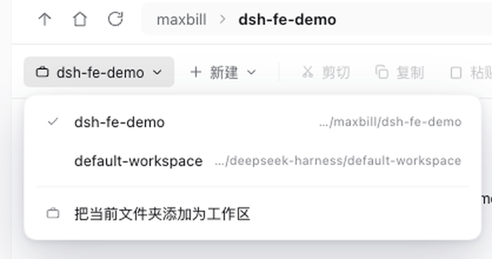
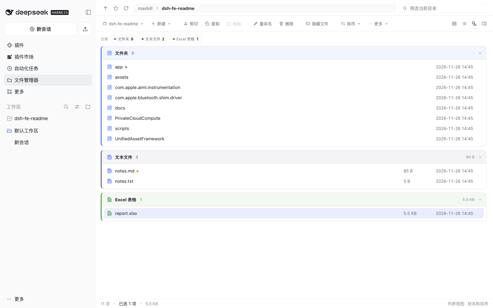
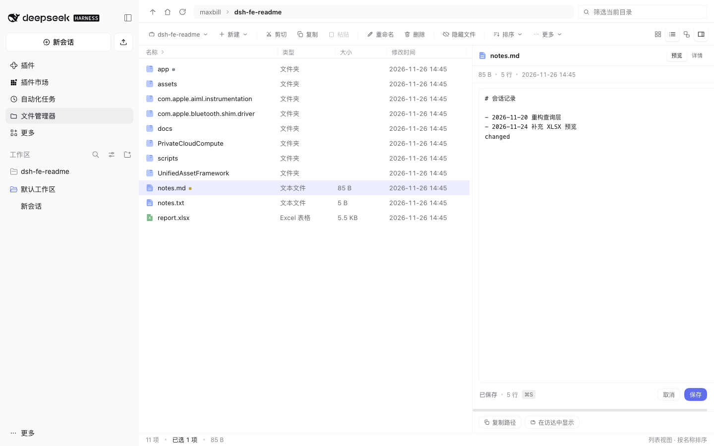

# 文件管理器 · dsh-file-explorer

**简体中文** | [English](README.en.md)

DeepSeek Harness 的**文件管理器**：左侧栏一个入口，主栏一整块面板 —— 三种视图、按类型预览（连 XLSX / DOCX 都能直接看）、面板内改文本、一键切工作区、把文件直接送进当前对话。

> 多数文件插件停在「能看文件」。这个多做了一步：**看完文件就能接着干活** —— 右键把文件夹变成 DSH 工作区，或把文档丢进当前对话，中间不用开访达、不用复制路径。


---

## 和 DSH 打通的五个动作

### ① 添加为工作区 · 文件夹右键

右键任意文件夹 → **添加为工作区** → 确认。左侧栏「工作区」立刻多一个入口，之后在这个目录开新会话，agent 的读写、终端、检索全落在它下面。

省掉的是那条绕路：先回 DSH 找「添加工作区」，再从主目录一层层点到目标文件夹。


### ② 添加到会话 · 文档右键

图片、文本、PDF、Word、Excel、PPT 右键 → **添加到会话**，面板切回当前对话，输入框里已经躺着那张附件卡片 —— 和把文件拖进输入框、点回形针的效果一样，但不用先离开文件管理器去找它。

接着直接问：「这份表格里哪几个月超预算？」「把这个 PDF 的结论列成三条。」


### ③ 引用到输入框 · 不占上下文

同一张菜单里的 **引用到输入框** 只把 `@/绝对/路径` 插进输入框，内容不进上下文，agent 需要时自己去读。适合代码、日志、大文件，以及还会继续改的文件 —— 省 token，也不会因为超过附件大小而上不去。

两条路的区别：**添加到会话**送内容，**引用到输入框**送位置。

### ④ 拖进会话 · 拖任意条目

选中文件（或一整个多选）→ 拖出列表，面板底部浮出「松手加入当前会话」。松手后文件作为附件落到输入框，文件夹作为 `@路径` 引用 —— 和右键「添加到会话」同一个落点，只是手不用离开鼠标。


### ⑤ 一键切换工作区 · 工具栏左侧

工具栏最左边就是当前目录所属的工作区（不在任何工作区时显示「工作区」）。点开是这台机器上的全部工作区，带路径尾部和当前项勾选，选一个面板直接跳过去；末尾还有「把当前文件夹添加为工作区」。

省掉「回侧栏 → 找工作区 → 再从主目录点下去」这一段。数据读的是 `ctx.workspaces` 的实时快照。



---

## 面板里能做什么

### 三种视图

- **图标视图**（默认）：文件夹以图标网格铺开，一格 104px；名字最多两行，超出按宽度阈值截断并以 `…` 收尾（中日文字符按双倍宽度算），两行高度始终预留，所以每格图标和文字都对得齐；悬停显示完整文件名。
- **列表视图**：一行给全 **名称 / 类型 / 大小 / 修改时间**，列分隔线可拖动改宽度，双击分隔线恢复默认。
- **分类视图**：按类型（文件夹 / 文本 / 图片 / 文档 / 音频 / 视频 / 压缩包 / 其他）分组，顶部是彩色概览条，每组用对应强调色标出图标、计数与总大小，点标题折叠。

切换用工具栏最右侧的图标（`⌘1` 图标、`⌘2` 列表，Windows 上是 `Ctrl`），选择会被记住。




### 预览与编辑

右侧面板按扩展名分流，覆盖范围和 DSH 自己的文档预览对齐：

| 类型 | 扩展名 | 渲染方式 |
|:--|:--|:--|
| 图片 | png / jpg / jpeg / gif / webp / bmp / ico / svg | `` 直接引用 `/raw`，不转 base64 |
| PDF | pdf | 浏览器自带阅读器，可翻页缩放，附「在新窗口打开」 |
| Markdown | md / markdown | 轻量渲染：标题、粗斜体、行内代码、链接、列表、引用、代码块 |
| 表格 | csv / tsv | 解析成表格（首行作表头，支持引号内逗号），最多 200 行 |
| Excel | xlsx / xlsm | **宿主自己解析** zip+XML，不依赖第三方库；按工作表分页签，首行作表头，最多 500 行 × 60 列 |
| Word | docx / docm | 同样宿主自解析：标题 / 正文 / 项目符号 / **表格** 按文档顺序还原，只取文字 |
| HTML | html / htm | 沙箱 iframe，不执行脚本 |
| 音频 / 视频 | mp3 / wav / m4a / flac / ogg / opus / aiff；mp4 / mov / webm / ogv | 原生播放器（DSH 自己不预览这两类） |
| 文本 / 代码 | 其余文本类 | 等宽只读，≤ 512 KB |
| 其他 | 二进制、Office 等 | 元信息 + 「用默认应用打开」 |

文本 / Markdown / CSV 预览时点 **编辑**，直接在面板内改：`⌘S` 保存，脏标记提示未保存，保存前检查文件是否被外部改动并询问是否覆盖，保存按钮是主色按钮、左侧显示行数。二进制扩展名（zip / 图片 / 音视频等）不会给编辑入口，避免把无法往返的字节写回去。



右侧面板还有 **详情** 模式：**名称 / 类型 / 大小 / 位置 / 创建时间 / 修改时间 / 权限**，文件夹额外给条目数。面板默认收起，点工具栏最右侧的预览图标展开。

### 整理与传输

- **新建**：文件夹 / 文件；**重命名**（`F2`，预选不含扩展名的部分）；**复制副本**；**剪切 / 复制 / 粘贴**（面板自己的剪贴板，跨目录可用）。
- **多选**：`⌘` 点按增减，`⇧` 点按选一段；批量剪切 / 复制 / 删除按整个选区执行。
- **撤销**：删除、重命名、移动、新建都能撤销（最近 20 步）。
- **移到废纸篓**：先确认，再进系统废纸篓，可找回；所有写入都不覆盖已有项，同名自动改成 `名称 2` / `名称 副本`。
- **下载 / 压缩 / 解压**：右键文件「下载」落到浏览器下载目录；「压缩为 ZIP」在它旁边生成同名压缩包；`.zip` → 「解压到此处」，会拒绝任何试图跳出目标目录的条目。ZIP 由宿主用 `zlib` 自己拼。
- **上传**（仅远程访问时出现）：流式写入宿主磁盘（不进内存），带进度条，单文件上限 512 MB。本机浏览器里这一项是隐藏的 —— 文件就在同一块磁盘上，用访达或「新建 / 粘贴」更直接。
- **Git 角标**：目录在 Git 仓库内时，已修改 / 未跟踪 / 已暂存 / 已删除 / 冲突的条目名后带彩色圆点，悬停看状态；只读 `git status --porcelain`，设 `GIT_OPTIONAL_LOCKS=0`，绝不碰索引。
- **地址栏**：双击面包屑（或 `⌘L`）变成可编辑路径，支持绝对路径、相对路径、`~` 和 `..`，`Esc` 取消，越出主目录会被拒绝。
- **筛选与排序**：按名称实时筛选；`名称 / 类型 / 大小 / 修改时间` 列头可点，文件夹恒在前。
- **状态栏**：条目数、已选数量与总大小、剪贴板内容；右侧显示当前视图与排序方式。
- **记忆**：隐藏文件开关、视图、分组样式、右侧面板模式、语言、动画效果、列宽、上次所在目录都记在浏览器里。

### 外观与设置

- **切换动画**：默认「滑动」，另有 **淡入**、**缩放**、**上浮**、**回弹**；原地刷新（改列宽、重命名后）只淡入。系统开了「减弱动态效果」时自动关闭。
- **多语言**：中文 / English，**选项 → 语言** 切换（默认「自动」跟随系统）。
- **选项窗口**：**更多 → 选项**，分显示 / 视图 / 分类视图 / 右侧面板 / 切换动画 / 语言几段，和工具栏图标同步，改哪边都一样。
- **关于**：版本、作者、构建日期、许可，直接读 `package.json`，不会和版本号脱节。

---

## 右键菜单一览

| 位置 | 条目 |
|:--|:--|
| 文件 / 文件夹 | 预览（文件夹为「打开」）、显示详情、用默认应用打开、在访达中显示、重新命名…、复制副本、拷贝、剪切、复制路径、复制相对路径、复制名称、下载（仅文件）、压缩为 ZIP、解压到此处（仅 .zip）、移到废纸篓 |
| 文件额外 | **添加到会话**（图片 / 文本 / PDF / Word / Excel / PPT）、**引用到输入框** |
| 文件夹额外 | **添加为工作区** |
| 空白处 | 新建文件夹…、新建文件…、粘贴、在访达中显示当前文件夹、刷新 |

---

## 平台支持

| 能力 | macOS | Windows | Linux |
|:--|:--|:--|:--|
| 浏览 / 预览（含 XLSX·DOCX）/ 编辑 / 上传 / 下载 / 压缩解压 | ✅ 已实测 | ⚠️ 未实测 | ⚠️ 未实测 |
| 用默认应用打开 | ✅ `open` | ✅ `cmd /c start` | ✅ `xdg-open` |
| 在文件管理器中显示 | ✅ `open -R` | ✅ `explorer /select,` | ✅ FileManager1（服务缺失时退回打开所在目录） |
| 移到废纸篓 | ✅ `~/.Trash` | ✅ 系统回收站（PowerShell，失败退回 `~/.Trash`） | ✅ freedesktop 废纸篓（带 `.trashinfo`，可还原） |
| 地址栏输入路径 | ✅ POSIX | ✅ 盘符 `C:\dir` 与 UNC `\\server\share` | ✅ POSIX |
| 上传整个文件夹 | ✅ | ✅ | ✅ `webkitdirectory`：Chrome / Edge / Firefox 支持，Safari 不支持（退化为选择文件） |

> ⚠️ **Windows 与 Linux 尚未在真机上完整验收。** 两个平台的分支按各自官方约定实现（Explorer 的 `/select,`、回收站的 `SendToRecycleBin`、freedesktop 的 `files`+`info` 目录结构），并在 `npm test` 里用「平台计划」用例模拟三套系统验证了命令与路径拼接，但没有实机点过一遍。遇到问题请到 [issues](https://github.com/MaxBill/dsh-file-explorer/issues) 附上系统版本、DSH 日志报错与复现步骤。

### 远程访问时的差异

通过 LAN 或隧道用浏览器访问时，**在宿主上执行且需要桌面会话**的动作会自动隐藏，底部状态栏显示「远程访问 · 本机操作已隐藏」：

- 在访达 / 资源管理器中显示（含空白处菜单与预览面板底部的按钮）
- 用默认应用打开
- 移到废纸篓（连带工具栏「删除」与 `Delete` 快捷键）

**上传**反过来只在远程出现 —— 它才是把本机文件送到宿主的通道，并带「从本机上传」提示。浏览、预览、编辑、下载、压缩解压、Git 角标、添加到会话、引用到输入框、添加为工作区都保留。

判定方式：宿主返回 `/env`，请求的 Host 是回环地址即视为本机；浏览器与宿主操作系统不一致（常见于 SSH 端口转发）也按远程处理。

## 安全边界

所有路径先 `realpath()` 再校验，`..` 与符号链接都逃不出浏览根目录（当前用户主目录），越界返回 `403`。预览上限：文本 512 KB、图片 8 MB；单目录最多列出 2000 项（超出时页脚提示已截断）。

宿主端 23 条路由都注册在 DSH 的 `connection` 服务上（`ctx.connection.fetch.register`），鉴权、Host / Origin 校验、浏览器登录态由宿主统一把关。

---

## 安装

插件包名是 **`@maxbill/dsh-file-explorer`**（npm 上 `dsh-file-explorer` 已被他人占用，所以走 scope）。三种装法任选：

**① 从 GitHub（免 npm）**

```sh
git clone https://github.com/MaxBill/dsh-file-explorer.git ~/.dsh/plugins/dsh-file-explorer
dsh plugin --profile desktop add link:$HOME/.dsh/plugins/dsh-file-explorer
```

**② 从 npm**（尚未发布，发布后可用）

```sh
dsh plugin --profile desktop add @maxbill/dsh-file-explorer
```

**③ 手动写进 profile**

```jsonc
// ~/.dsh/profiles/<profile>/package.json
{
  "dependencies": { "@maxbill/dsh-file-explorer": "link:../../plugins/dsh-file-explorer" },
  "dsh": { "profile": { "bundles": [ "@maxbill/dsh-file-explorer" ] } }
}
```

然后在该 profile 目录 `pnpm install`，重启 DSH。装好后左侧栏出现「文件管理器」入口。

> Loader 里的**条目 id 仍是 `dsh-file-explorer`**（`cordis.patch.yml` 的 `id:`），只是加载的模块名换成了 scoped 包名。

## 卸载

从 `dsh.profile.bundles` 与 `dependencies` 中删掉 `@maxbill/dsh-file-explorer`，再跑一次 `pnpm install`。

## 开发

```sh
npm test        # host 端 HTTP 接口测试，在 $HOME 下的临时目录里做，结束后清理
```

没有构建步骤：`lib/index.js` 是普通 ESM，`lib/client.js` 是手写的 `window.__ModuleLoader__` 工厂模块。

**发布到 npm**（维护者）：`package.json` 已声明 `publishConfig.access = "public"`，登录后直接发即可。

```sh
npm login                                   # 需要属于 @maxbill scope 的账号
npm publish                                 # 会带上 lib / assets / docs / locale
```

发完把版本号写进 `package.json` 前先确认它和 GitHub Release 的 tag 一致。

| 文件 | 作用 |
|:--|:--|
| `lib/index.js` | Host 端：把 `/api/file-explorer` 的 23 条路由注册到 DSH `connection` 服务，路径统一 `realpath` 收敛在 `$HOME` |
| `lib/client.js` | 浏览器端：注册左侧栏图标与 `main` 面板，零依赖（只要 `react`） |
| `cordis.patch.yml` | Bundle patch，把 Loader 条目 `dsh-file-explorer` 插入 |
| `assets/icons/` | 12 个可直接取用的双色 SVG（`node scripts/export-icons.mjs` 从 `SHAPES` 导出） |

## 分支模型

- `main`：稳定分支，只通过 PR 从 `develop` 合并进来，已开启分支保护（管理员同样受限，禁止强推与删除）。
- `develop`：日常开发都在这里，跑完测试再合。

```sh
git switch develop
# ...改代码、提交、跑测试...
git push origin develop
gh pr create --base main --head develop
```

合并用 rebase 保持线性历史，合并后把 develop 对齐到 main：

```sh
git switch develop && git fetch origin && git reset --hard origin/main
```

## 开发者

| 项目 | 信息 |
|:--|:--|
| 开发者 | **MaxBill** |
| 开发者首页 | <https://github.com/MaxBill> |
| 项目仓库 | <https://github.com/MaxBill/dsh-file-explorer> |
| 问题反馈 | <https://github.com/MaxBill/dsh-file-explorer/issues> |

## 许可

[Apache License 2.0](LICENSE) © 2026 MaxBill
