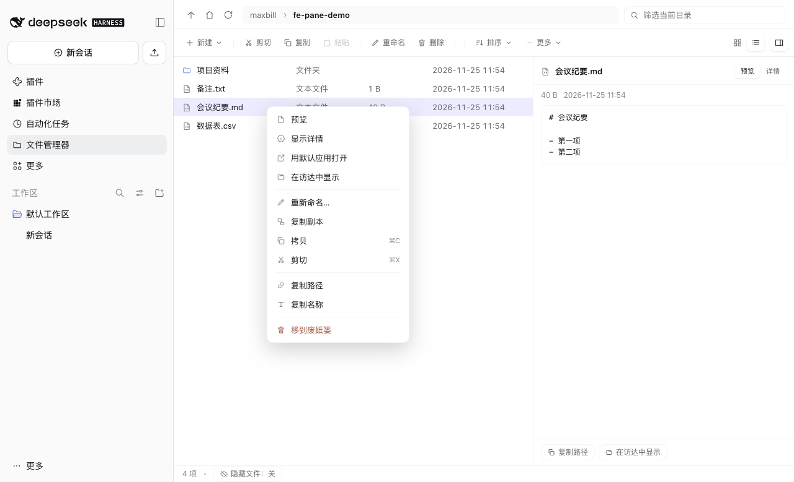
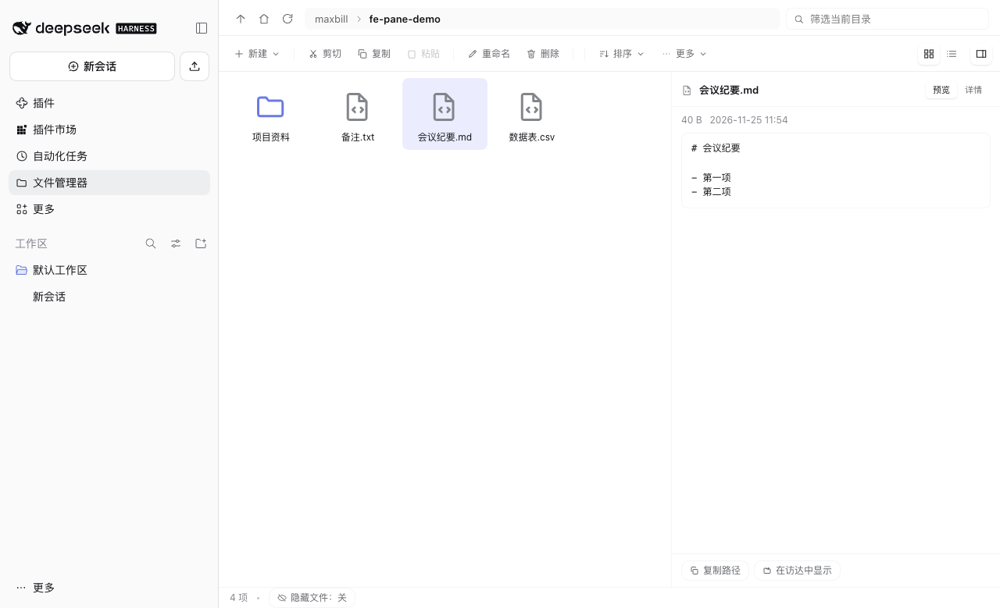

# File Explorer · dsh-file-explorer

A **文件管理器** entry in the DeepSeek Harness left sidebar that opens a full file browser in the main column: browse folders, filter, and preview text and images.

| List view with the context menu | Icons view |
|:--|:--|
|  |  |


Repository: <https://github.com/MaxBill/dsh-file-explorer> · Developer: [MaxBill](https://github.com/MaxBill) · License: MIT

## What it does

- **Left sidebar entry** — registered in `sidebar.panellist` with a folder glyph; the same id addresses the panel registered in the `main` keyed slot.
- **Browsing** — breadcrumbs, up, home, refresh; double-click a folder to enter it.
- **Address bar** — the tinted breadcrumb strip doubles as a path field: double-click it (or press `⌘L`), type an absolute, relative or `~` path and press Enter. `Esc` cancels, and a path outside the home root is refused.
- **Filter and sort** — live name filter; the toolbar's 排序 menu sorts by name, size or modified time, with folders always first.
- **View modes** — the two icons at the far right of the toolbar switch **icons / list** (⌘1 icons, ⌘2 list, Ctrl on Windows). **Icons is the default**: the folder lays out as a grid. The list shows name, type, size and modified time in one row. The choice is remembered for the next session.
- **Hidden files** — dotfiles are hidden by default and shown with one toggle.
- **Preview** — text files up to 512 KB render as monospace text, images up to 8 MB render inline from a data URL, anything else shows its metadata. The preview icon at the far right of the toolbar collapses or restores the right-hand pane; collapsed, the list takes the full width.
- **Details pane** — right-click "显示详情", or flip the right pane to 详情, to see name, type, size, location, created, modified and permissions. Folders have no preview, so selecting one shows its details (size reads as an item count).
- **Quick toolbar** — **新建** (new folder / new file) first, then cut, copy, paste, rename and delete, then **排序** (name / size / modified) and **更多** (undo, select all, deselect all, invert selection, options) on the right. Buttons grey out when nothing is selected.
- **Multi-select** — `⌘`-click to add or drop single rows, `⇧`-click to select a range; cut, copy and delete act on the whole selection.
- **Undo** — delete, rename, move and create can all be undone (the last 20 steps), and the listing refreshes afterwards.
- **Context menu** — right-click a file or folder, or the empty area, for the common operations (see below).
- **Keyboard** — `↑`/`↓` to select, `Enter` to open, `Backspace` to go up, `F2` to rename, `⌘C`/`⌘X`/`⌘V` to copy, cut and paste, `Delete` to move to the Trash, `⌘1`/`⌘2` to switch views, `⌘A` to select all, `⌘⇧A` to deselect all, `⌘⌥A` to invert, `Esc` to clear, `⌘L` to edit the address bar.
- **Remembers the folder** — switching to another panel and back keeps the last directory.

## Context menu

**File or folder**: preview (open, for folders), open with the default app, reveal in Finder, rename…, duplicate, copy, cut, copy path, copy name, move to Trash.

**Empty area**: new folder…, new file…, paste, reveal this folder, refresh.

- Copy and cut put the path on the panel's own clipboard; pasting in another folder copies or moves it, and the footer shows what is on the clipboard.
- Move to Trash asks first, then moves the item into `~/.Trash`, so it stays recoverable.
- No write operation overwrites: a name clash becomes `name 2` / `name 副本` (or a `409` for a rename onto an existing name).
- Rename and create use in-panel dialogs: `Enter` confirms, `Esc` cancels, and rename preselects the name without its extension.

## Safety

Every requested path is resolved with `realpath()` before the containment check, so neither `..` segments nor symbolic links escape the browsing root. The root is the current user's home directory, and out-of-root requests answer `403`.

Limits: 512 KB of text, 8 MB of image, 2000 entries per directory (the footer says when a listing is truncated).

## Layout

| File | Role |
|:--|:--|
| `lib/index.js` | Host half: registers the `/api/file-explorer` prefix route on the DSH web server (`roots`, `list`, `read`, `reveal`) |
| `lib/client.js` | Browser half: a `window.__ModuleLoader__` factory module registering the sidebar icon and the `main` panel |
| `cordis.patch.yml` | Bundle patch that inserts the `file-explorer` Loader entry |

## Install

The plugin mounts the standard DSH bundle way:

```jsonc
// ~/.dsh/profiles/<profile>/package.json
{
  "dependencies": { "dsh-file-explorer": "link:../../plugins/dsh-file-explorer" },
  "dsh": { "profile": { "bundles": [ "dsh-file-explorer" ] } }
}
```

Then run `pnpm install` in that profile directory and restart DSH. `dsh plugin --profile <profile> add <path>` does the same through the CLI.

Installing from source:

```sh
git clone https://github.com/MaxBill/dsh-file-explorer.git ~/.dsh/plugins/dsh-file-explorer
```

Then point the `link:` dependency above at that directory.

## Development

```sh
npm test        # exercises the host HTTP API in a scratch folder under $HOME, then cleans up
```

There is no build step: `lib/index.js` is plain ESM and `lib/client.js` is a hand-written `window.__ModuleLoader__` factory module.

## Uninstall

Remove `dsh-file-explorer` from `dsh.profile.bundles` and `dependencies`, then run `pnpm install` again.

## Developer

| Field | Value |
|:--|:--|
| Developer | **MaxBill** |
| Homepage | <https://github.com/MaxBill> |
| Repository | <https://github.com/MaxBill/dsh-file-explorer> |
| Issues | <https://github.com/MaxBill/dsh-file-explorer/issues> |

## License

MIT