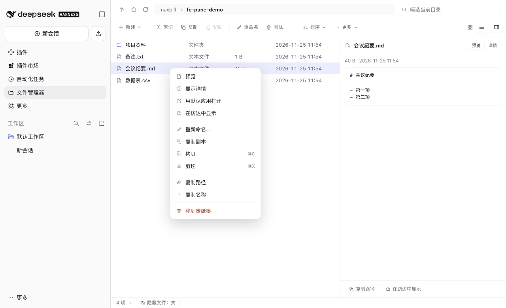
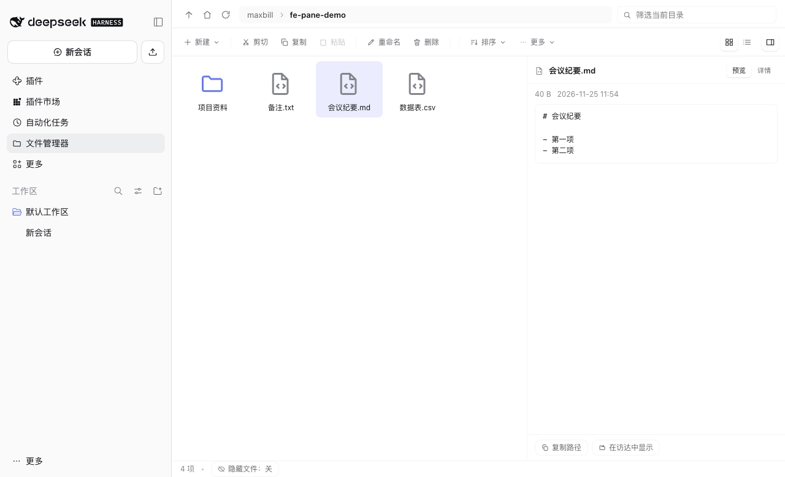
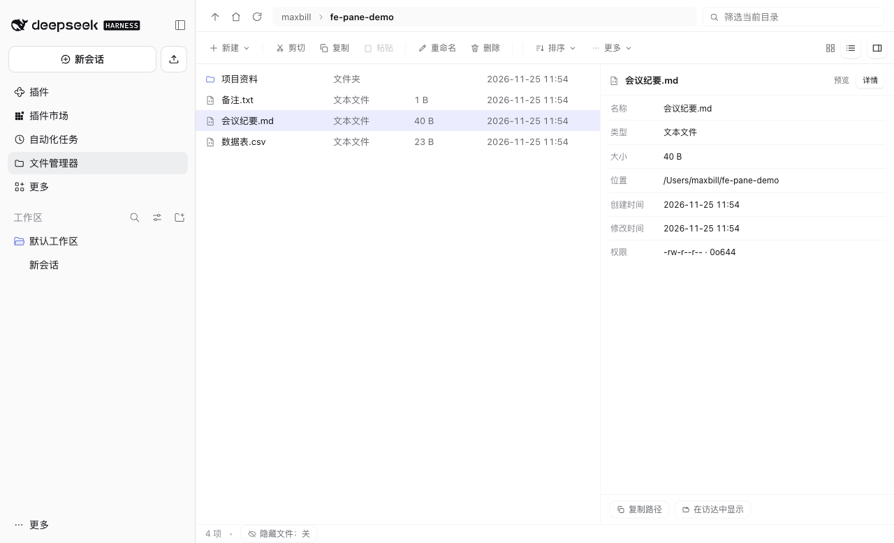
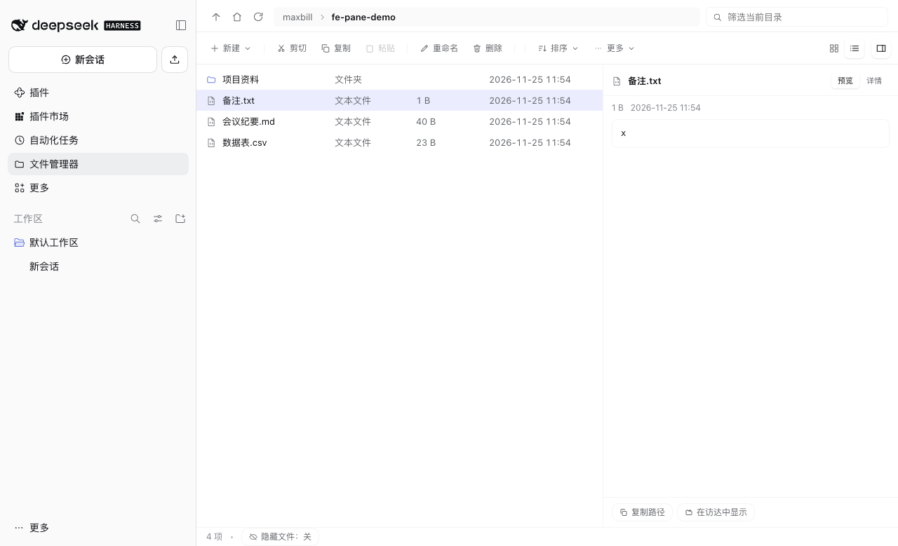

# 文件管理器 · dsh-file-explorer

给 DeepSeek Harness 左侧栏加一个 **文件管理器** 入口：点开就在主栏里浏览本机文件、筛选目录、预览文本与图片。

| 列表视图与右键菜单 | 图标视图 |
|:--|:--|
|  |  |





仓库：<https://github.com/MaxBill/dsh-file-explorer> · 开发者：[MaxBill](https://github.com/MaxBill) · 许可：MIT

## 功能

- **左侧栏入口**：注册在 `sidebar.panellist`，图标为文件夹；同一 id 打开 `main` 面板。
- **目录浏览**：面包屑导航、上一级、回到主目录、刷新；双击文件夹进入。
- **地址栏**：面包屑外面的浅色输入条，**双击**（或 `⌘L`）变成可编辑路径，回车跳转；支持绝对路径、相对路径、`~` 和 `..`，`Esc` 取消，越出主目录会被拒绝。
- **筛选与排序**：按名称实时筛选；用工具栏的「排序」菜单按名称 / 大小 / 修改时间排序，文件夹恒在前。
- **显示视图**：工具栏最右侧两个图标切换 **图标 / 列表**（`⌘1` 图标、`⌘2` 列表，Windows 上是 `Ctrl`）。**图标视图是默认**，文件夹以图标网格铺开；列表视图一行给全 **名称 / 类型 / 大小 / 修改时间**。选择会记住，下次打开还是上次的视图。
- **隐藏文件开关**：默认隐藏 `.dotfile`，一键显示。
- **预览**：文本文件（≤ 512 KB）直接显示，图片（≤ 8 MB）以内联 data URL 显示，其余显示元信息。工具栏最右侧的预览图标可一键**收起 / 展开**右侧面板，收起后列表占满整宽。
- **详情面板**：右键「显示详情」，或在右侧面板切到「详情」，查看 **名称 / 类型 / 大小 / 位置 / 创建时间 / 修改时间 / 权限**；文件夹没有预览，选中即自动显示详情（大小位置显示条目数）。
- **快捷工具栏**：**新建**（文件夹 / 文件）、剪切、复制、粘贴、重命名、删除，然后是 **排序**（名称 / 大小 / 修改时间）与 **更多**（撤销、全部选择、全部取消、反向选择、选项）。未选中条目时相关按钮自动置灰。
- **多选**：`⌘` 点按逐个增减，`⇧` 点按选一段；批量剪切 / 复制 / 删除都按整个选区执行。
- **撤销**：删除、重命名、移动、新建都能撤销（保留最近 20 步），撤销后自动刷新列表。
- **右键菜单**：文件和文件夹右键、空白处右键，各有常用操作（见下）。
- **键盘**：`↑`/`↓` 选择，`Enter` 打开，`Backspace` 上一级，`F2` 重命名，`⌘C`/`⌘X`/`⌘V` 拷贝剪切粘贴，`Delete` 移到废纸篓，`⌘1`/`⌘2` 切换视图，`⌘A` 全选、`⌘⇧A` 全部取消、`⌘⌥A` 反向选择、`Esc` 清空选择，`⌘L` 编辑地址栏。
- **记忆位置**：切换面板（例如回到对话）后再点回来，仍停在刚才的目录。

## 右键菜单

**文件 / 文件夹**：预览（文件夹为「打开」）、用默认应用打开、在访达中显示、重新命名…、复制副本、拷贝、剪切、复制路径、复制名称、移到废纸篓。

**空白处**：新建文件夹…、新建文件…、粘贴、在访达中显示当前文件夹、刷新。

- 「拷贝 / 剪切」把路径放进面板内的剪贴板，切到别的目录「粘贴」即可复制或移动；底部栏会显示当前剪贴板内容。
- 「移到废纸篓」会先弹确认框，对象进系统废纸篓（`~/.Trash`），可以从废纸篓找回，不会直接删除。
- 所有写入操作都不覆盖已有项：同名冲突时自动改成 `名称 2`、`名称 副本`，或返回 `409`。
- 重命名 / 新建用面板内的对话框，`Enter` 确认、`Esc` 取消；重命名会预选中不含扩展名的部分。

## 安全边界

所有路径都先 `realpath()` 再校验，因此 `..` 与符号链接都无法逃出浏览根目录；根目录固定为当前用户主目录。越界请求返回 `403`。

预览上限：文本 512 KB，图片 8 MB；单目录最多列出 2000 项（超出时页脚提示已截断）。

## 结构

| 文件 | 作用 |
|:--|:--|
| `lib/index.js` | Host 端：在 DSH Web Server 上注册 `/api/file-explorer` 前缀路由（`roots` / `list` / `read` / `reveal`） |
| `lib/client.js` | 浏览器端：`window.__ModuleLoader__` 工厂模块，注册左侧栏图标与 `main` 面板 |
| `cordis.patch.yml` | Bundle patch，把 `file-explorer` 条目插入 Loader |

## 安装

插件按 DSH 的标准 bundle 方式挂载：

```jsonc
// ~/.dsh/profiles/<profile>/package.json
{
  "dependencies": { "dsh-file-explorer": "link:../../plugins/dsh-file-explorer" },
  "dsh": { "profile": { "bundles": [ "dsh-file-explorer" ] } }
}
```

然后在该 profile 目录执行 `pnpm install`，重启 DSH。也可以用 `dsh plugin --profile <profile> add <路径>`。

从源码安装：

```sh
git clone https://github.com/MaxBill/dsh-file-explorer.git ~/.dsh/plugins/dsh-file-explorer
```

再把上面的 `link:` 依赖指向该目录即可。

## 开发

```sh
npm test        # 跑 host 端 HTTP 接口测试（在 $HOME 下的临时目录里做，结束后清理）
```

插件没有构建步骤：`lib/index.js` 是普通的 ESM，`lib/client.js` 是手写的 `window.__ModuleLoader__` 工厂模块。

## 卸载

从 `dsh.profile.bundles` 与 `dependencies` 中删掉 `dsh-file-explorer`，再跑一次 `pnpm install`。

## 开发者

| 项目 | 信息 |
|:--|:--|
| 开发者 | **MaxBill** |
| 开发者首页 | <https://github.com/MaxBill> |
| 项目仓库 | <https://github.com/MaxBill/dsh-file-explorer> |
| 问题反馈 | <https://github.com/MaxBill/dsh-file-explorer/issues> |

## 许可

MIT